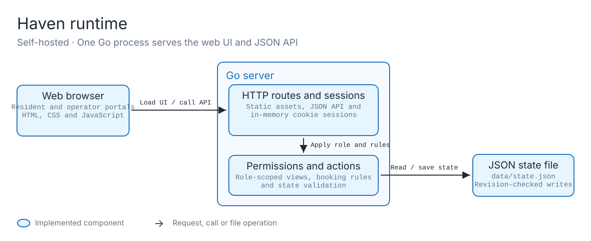
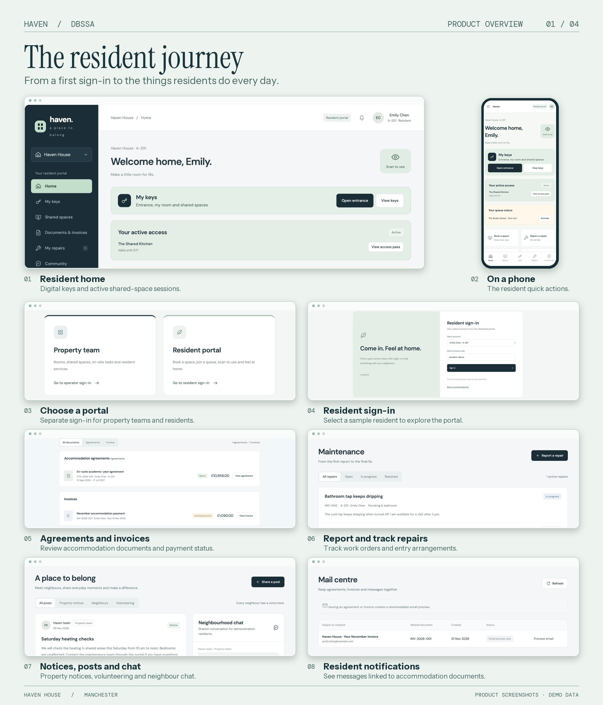
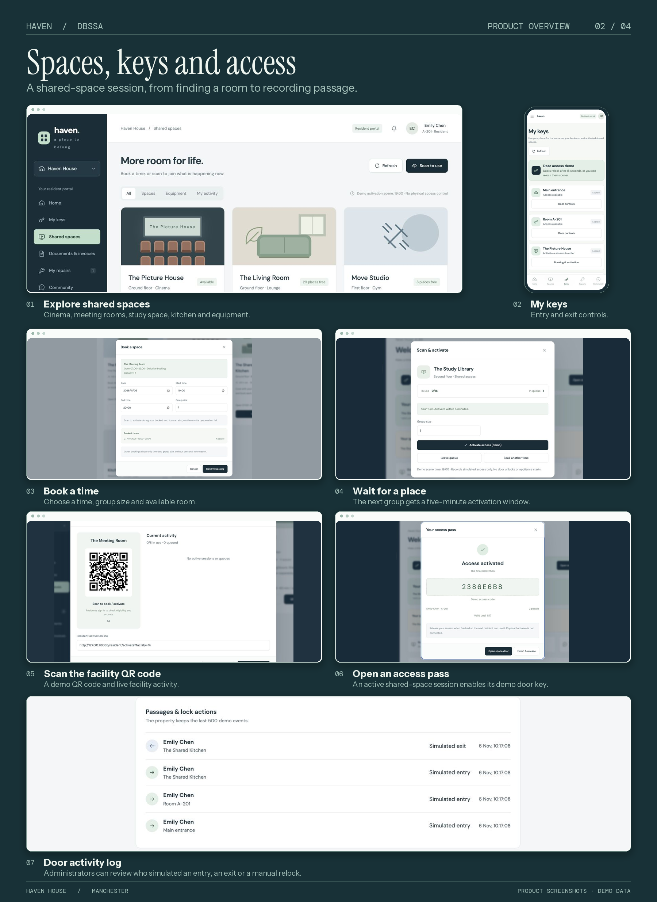
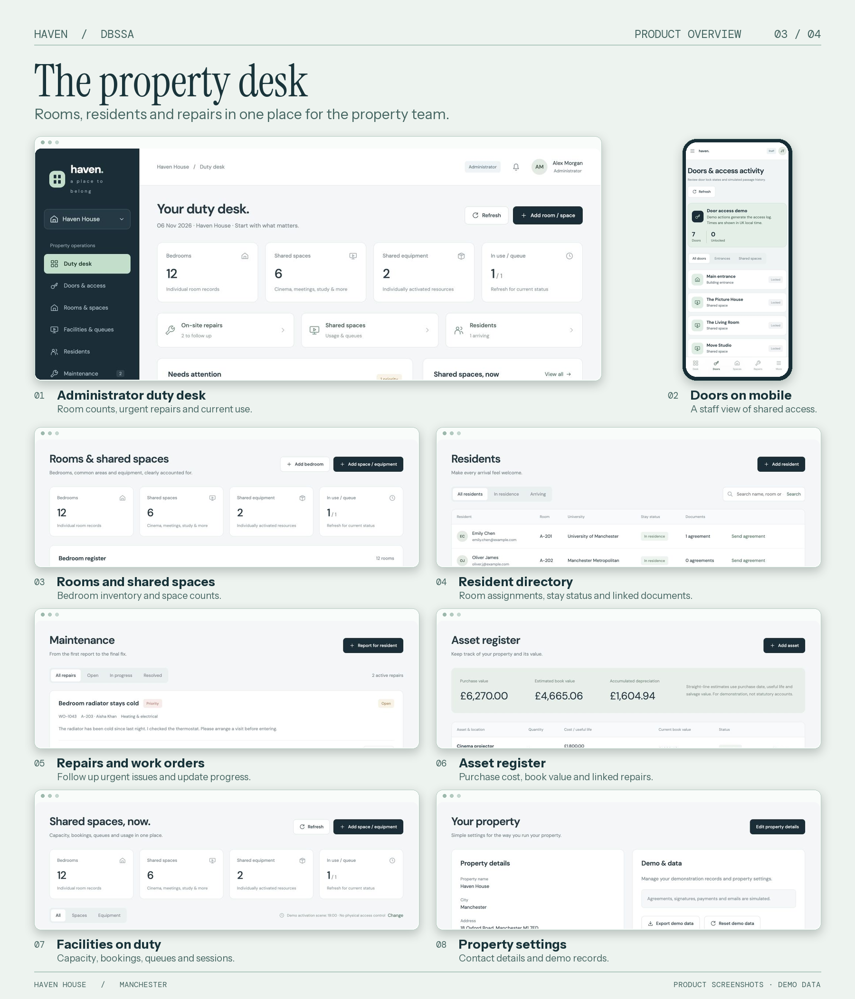
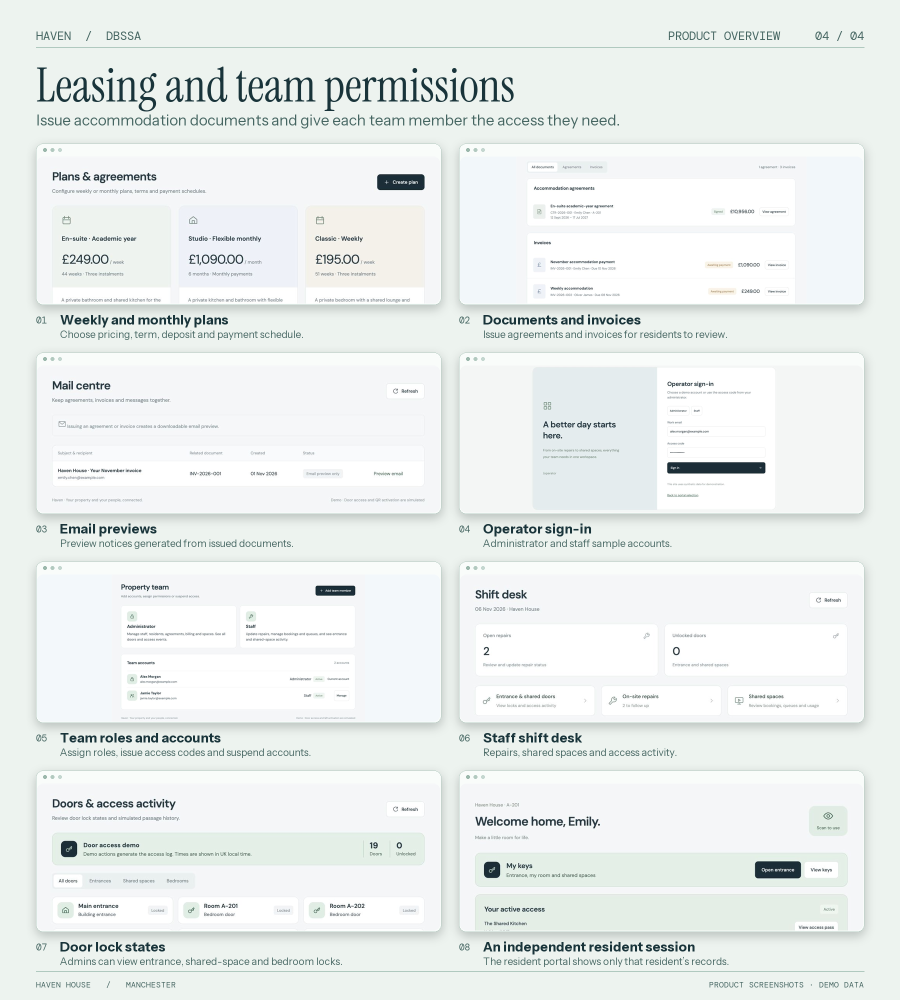

# DBsSA · Haven

Haven is a Go web application for student accommodation. It gives residents a place to book shared spaces, review agreements and invoices, and report repairs. Property teams use a separate portal to manage rooms, residents, facilities and access.

## Quick start

Install Go 1.22 or later. From the repository root, run the following commands.

```sh
cd haven
go run ./backend
```

Open [http://127.0.0.1:8088](http://127.0.0.1:8088). Choose **Resident portal** and select Emily Chen, or choose **Property team** and select Administrator or Staff. The forms fill in the demo access codes.

| Setting | Default |
| --- | --- |
| `DBSSA_ADDR` | `127.0.0.1:8088` |
| `DBSSA_DATA` | `data/state.json`, relative to `haven/` when run as shown above |

## Architecture



[PNG](docs/architecture/haven-runtime.png) · [Editable Excalidraw](docs/architecture/haven-runtime.excalidraw)

> **Storage note.** The JSON file shown in the diagram is a lightweight demo default. You can adapt persistence to MySQL, PostgreSQL or another database, and use object storage for documents, images and other files. These options require implementing the corresponding storage integration while preserving permission checks, data validation and concurrent update handling.

| Layer | Implementation |
| --- | --- |
| Web interface | Responsive HTML, CSS and JavaScript modules in [`haven/public/portal/`](haven/public/portal/). Go serves the files directly, with no frontend build step. |
| HTTP service | A single Go process uses the standard-library `net/http` package to serve the portals and a same-origin JSON API. [`main.go`](haven/backend/main.go) |
| Sessions and permissions | Resident and operator logins use separate cookies. Session records live in memory. Go filters each role's view and checks permissions before applying actions. [`portal.go`](haven/backend/portal.go) · [`access.go`](haven/backend/access.go) |
| Business state | Go loads the JSON state at startup or uses the bundled seed. It validates changes, checks the revision to reject stale updates, and saves by atomically replacing the file. State survives a restart. Demo sign-ins are required again after a restart. [`main.go`](haven/backend/main.go) · [`seed.json`](haven/backend/seed.json) |

Each portal has three JSON endpoints under `/api/resident/` or `/api/operator/`. The `session` endpoint handles sign-in, `state` returns the authorised view and accepts permitted updates, and `action` handles operations such as bookings, queue changes and door access. `GET /healthz` reports service health.

## What you can try

| Role | Workflows |
| --- | --- |
| Resident | Book or queue for shared spaces, activate a session with a QR link, use demo keys, review agreements and invoices, track repairs, and join community discussions. |
| Administrator | Manage rooms, residents, staff, facilities, weekly and monthly rent plans, agreements, invoices, repairs and assets. Review all simulated door activity. |
| Staff | Update repairs, manage facility bookings and queues, and review entrance and shared-space access activity from the shift desk. |

The bundled data describes one sample property with 12 bedrooms, six shared spaces and two bookable ovens. Accounts and records are synthetic. Signing, payment confirmation, email and door access are simulated.

## Product showcase

Select a board to see the full-size screenshots.

| Resident experience | Shared spaces and access |
| --- | --- |
| [](docs/showcase/01-resident-journey.png) | [](docs/showcase/02-spaces-and-access.png) |
| **Property operations** | **Leasing and team permissions** |
| [](docs/showcase/03-property-operations.png) | [](docs/showcase/04-leasing-and-team.png) |

## Hosted preview

The hosted preview requires authorised ChatGPT access. It serves the same web interface and API routes through a TypeScript adapter on Cloudflare Workers, with D1 for demo state and sessions. The self-hosted Go application runs independently and uses its own local data.

[Resident preview](https://dbssa-apartment-home-20261106.waiyuchan.chatgpt.site/resident/login) · [Operator preview](https://dbssa-apartment-home-20261106.waiyuchan.chatgpt.site/operator/login)

## Tests

Run the Go and JavaScript tests from `haven/`. The JavaScript tests use Node.js 22.

```sh
go test -race ./backend
node --test public/portal/domain.test.mjs tests/facility.test.mjs
```

Run the HTTP tests against a running instance with disposable demo data. They create bookings and modify sample records.

```sh
node tests/portal-http.mjs
node tests/access-http.mjs
```
